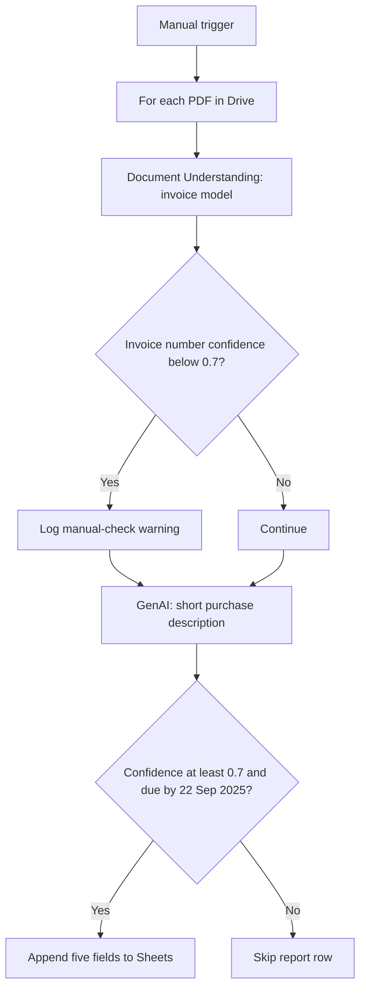

# Invoice Reporting with UiPath Web Studio

Jason Teixeira · TripleTen AI Automation · Project 6

**Status: revised and resubmitted; TripleTen review in progress.** On October 29, 2026, all six PDFs were processed in a successful Studio debug run. The sheet contains four populated rows, and the run logged the requested low-confidence invoice-number warning. A revised 14-slide presentation adds live UiPath configuration screenshots for all four requested activities, the skipped Else branch, and the Document Understanding warning.

**Revised presentation:** [Invoice-Reporting-Presentation-Revised.pptx](submission-package/Presentation/Invoice-Reporting-Presentation-Revised.pptx) or [complete revised ZIP](Invoice-Reporting-Submission-Revised.zip). The original submission remains available for comparison.

The [live Google Slides deck](https://docs.google.com/presentation/d/1qOMtMsHBpJHjYEha4O_VBPXVe0JN2G0ESTgIWDukNDQ/edit) now includes the six evidence slides and allows anyone with the link to view it.

The [TripleTen Project 6 review](https://tripleten.com/trainer/ai-auto/lesson/aac314fb-e22e-4126-aafc-61a025c5b324/?from=program&tab=1) accepted the updated project link and displayed “Your project is under review.” [Resubmission status screenshot](evidence/tripleten-resubmission-status.jpg) · [live mappings slide screenshot](evidence/live-slides-mappings.jpg).

## Project links

- [UiPath workflow](https://cloud.uipath.com/sageideasllc/studio_/designer/d9b96923-0a75-4b56-9910-65b2947083f0?solutionId=7d9a4655-6550-4d5b-8ee9-08df3048409f)
- [Google Drive input folder](https://drive.google.com/drive/folders/16fhX_YrWZJb60o3myeo7fmAWlRtWdDfj)
- [Google Sheet](https://docs.google.com/spreadsheets/d/1rUDw-2mJnMi5nBwOikze-hPChpt_7e-k_3MpVrM8wVU/edit)
- [Presentation](https://docs.google.com/presentation/d/1qOMtMsHBpJHjYEha4O_VBPXVe0JN2G0ESTgIWDukNDQ/edit)
- [TripleTen assignment](https://tripleten.com/trainer/ai-auto/lesson/aac314fb-e22e-4126-aafc-61a025c5b324/)

## Workflow

The sample due September 22 was included and the sample due September 30 excluded. The cutoff comparison uses a timezone-bearing midnight, so other time-bearing inputs should be tested separately. GenAI runs before the final eligibility gate, including for low-confidence and later-due invoices. Missing fields and rerun behavior need review; rerunning currently appends duplicate rows.

## Files

- [UiPath solution export](uipath/Invoice-Reporting.uis): downloaded October 29, 2026. It includes connection and tenant/resource identifiers; review before publication. It is a snapshot, not proof of a successful run.
- [Main.xaml](uipath/Main.xaml): readable copy from the export.
- [Presentation export](Invoice-Reporting-Presentation.pptx): eight-slide copy with the report and warning screenshots.
- [Revised presentation](submission-package/Presentation/Invoice-Reporting-Presentation-Revised.pptx): 14-slide copy with six additional live configuration and warning screenshots.
- [Configuration evidence](evidence/configuration/): full-screen captures from UiPath Studio Web; the presentation embeds cropped copies for legibility.
- [input/](input/): all six supplied PDFs and the original archive.
- [Submission checklist](SUBMISSION.md).

The brief alternates between four, five, and six invoices; the supplied archive contains six. It also mentions total-amount confidence once, while the main requirement and rubric specify invoice-number confidence. The workflow follows the latter.

## Source-PDF checks

These values were read from the supplied PDFs, not generated by UiPath. They are a test oracle, not evidence of a run.

| Invoice | Supplier | Due | Total | Cutoff |
| --- | --- | --- | ---: | --- |
| CR-2025-118 | Camp Rock Catering Services LLC | 2025-09-15 | $2,250.00 | Within |
| IT-2025-044 | TechNova AV Solutions | 2025-09-20 | $2,950.00 | Within |
| MK-2025-301 | Creative Edge Marketing | 2025-09-22 | $1,750.00 | Boundary: include |
| OF-2025-077 | Office Supplies Plus | 2025-09-18 | $430.00 | Within |
| CN-2025-552 | ConnectNet Communications | 2025-09-30 | $1,200.00 | Exclude |
| SS-2025-209 | StarSound Rentals | Unverified: faint scan | $800.00 balance visible | Review extracted date and invoice number |

The run produced the four eligible rows above with matching numbers, suppliers, dates, and totals. Each includes a short generated description. The warning log was triggered once; the log does not identify the source filename.

## Reviewer warning check

UiPath Studio displays: “DU models not currently defined as part of Solution definitions. Please make sure they are created manually and exist when deploying the solution to other tenants.” The configured extraction uses the tenant's **Predefined → Production → Invoices** model. This banner concerns solution portability to another tenant; it does not report that the October 29 local debug run failed. A separate GenAI banner similarly notes that indexes are not included in Solution definitions. No deployment to another tenant was tested.
