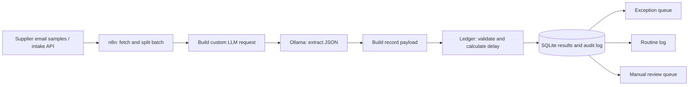

# Supplier Delay Triage — TripleTen Final Project

**Jason Teixeira · AI Automation capstone · October 30, 2026**

A new workflow for a small wholesale or retail operations team. It converts unstructured supplier delivery updates into a structured exception register, with deterministic validation and a manual-review queue. It does not reuse the invoice, hotel chatbot, feedback-analysis, or weather-planning projects.

## Review this final project

- **[View the 14-slide presentation (PDF)](presentation/Supplier-Delay-Triage-Jason-Teixeira-Final.pdf)**
- [Download the editable PowerPoint](presentation/Supplier-Delay-Triage-Jason-Teixeira-Final.pptx?raw=1)
- [Download the complete audited submission package](submission/TripleTen-Final-Project-Jason-Teixeira-Audited.zip?raw=1)
- [Read the project submission and reflection](SUBMISSION.md)
- [Check the requirement-by-requirement audit](RUBRIC-AUDIT.md)
- [Inspect the n8n workflow](workflows/supplier-delay-triage.json), [custom prompt](prompt.txt), and [sample inputs](samples/messages.json)
- [Inspect structured results](evidence/results.csv), [field accuracy](evidence/field-accuracy.json), and [verification evidence](evidence/VERIFICATION.md)

**Demonstrated results:** 6/6 expected routes; 36/36 checked core extraction fields; successful controlled outage and duplicate tests; 34 passing automated tests with 94% ledger line coverage. These measurements apply to the included small fictional test set.

This repository publishes the project files and evidence. The workflow is a tested local prototype, not a hosted inbox service. The downloadable ZIP contains the audited handoff with execution-resume tokens redacted and checksums regenerated; the repository adds these navigation links. Course submission is a separate step.

## Reviewer-requested implementation evidence revision

The original 14-slide presentation and its 34-test evidence remain available above. A local revision adds a native n8n Switch and three visible outcome branches, expands verification to **42 passing tests**, and preserves the original business-rule validator.

The new actual run routes **2 exceptions, 1 routine item and 3 manual reviews**. SUP-003 enters review because the new model response changed the capitalization of its source quote, which fails the exact-quote check. All 36 checked core extraction fields still match the source fixtures. The original **3 exceptions / 1 routine / 2 reviews** is a separate earlier run, not the new run's result.

The n8n owner-account setup must finish before the required editor configuration screenshots can be captured. Those screenshots and the revised presentation are **not yet complete**. See [revision status](evidence/reviewer-fix/REVISION-STATUS.md). This status is kept explicit so the original submission is not mistaken for an approved revision.

## Manual process and business value

1. Open each supplier email and find the purchase-order number.
2. Read the message to identify a delay, short shipment, or on-time confirmation.
3. Copy delivery dates and quantities into a tracker.
4. Calculate lateness and decide whether to escalate.
5. Follow up on uncertain details and check for duplicate entries.

Reading and copying are repetitive. Missing an exception can leave staff planning around an outdated arrival date. AI extracts and summarizes the text; deterministic code checks its output. People keep responsibility for contacting suppliers and changing orders.

**Illustrative estimate, not measured savings:** 40 updates/week × 4 minutes manual handling = 160 minutes. At 1 minute of human review per update, review takes 40 minutes: an estimated 120 minutes/week saved (75%). This excludes setup, inference waiting, and failure recovery. A real pilot must measure handling time and error rates before using the estimate operationally.

## Connected services

- **n8n 2.45.7** orchestrates the workflow using a manual batch trigger and eleven nodes.
- **Ollama / Qwen2.5 3B** (a CPU-only runtime built from official Ollama binaries) is a real local LLM service, called over HTTP with a custom prompt and JSON Schema.
- **Operations Ledger API / SQLite** provides external input from uploaded JSON fixtures and persists structured output and an audit trail.

All service traffic stays on the local Docker network. Only the read/write demonstration ledger API is reachable at `127.0.0.1:8091`; it is a development fixture service, not an authenticated production deployment. No SaaS plan, API key, or cloud publication is required.

## Workflow



The AI call continues to the recording step if it fails. Validation routes low-confidence, ambiguous, malformed, unsupported, or contradictory output to `manual_review`. Valid delays and short shipments become `exception`; valid on-time updates become `logged`. A delay of at least three days gets `high` priority. The ledger recalculates routing; it never trusts an AI-supplied route.

The CPU Dockerfile copies the official runtime binaries and bundled notices, leaving out unused CUDA/JetPack directories. The pinned upstream Ollama digest is in `Ollama.CPU.Dockerfile`. The downloaded model is stored in `.runtime/ollama` on the host, separate from the submission files.

## Run locally

Docker Desktop must be running. Run commands in this directory:

```bash
docker compose up -d ollama ledger
docker compose exec ollama ollama pull qwen2.5:3b
python3 src/build_workflow.py
docker compose run --rm n8n import:workflow --input=/workflows/supplier-delay-triage.json
docker compose run --rm n8n execute --id=supplierDelayCapstone2026 --rawOutput
```

View `http://127.0.0.1:8091/results`, `/audit`, or `/results.csv`. Source examples are in `samples/messages.json`. Replace the contents with a **new batch using new, stable message IDs** to demonstrate another input. Keep the JSON structure and field limits. This demo uses fixture email records fetched through an external API; it does not monitor a real inbox or claim unattended execution.

A separate controlled outage test deliberately calls a closed LLM port, using `FAILURE-001`. It must log a review item instead of stopping silently:

```bash
docker compose run --rm n8n import:workflow --input=/workflows/controlled-llm-outage.json
docker compose run --rm n8n execute --id=supplierFailureCapstone2026 --rawOutput
```

Replaying the successful workflow preserves the first result for each message ID and logs `duplicate_skipped`. Corrected supplier messages need new versioned IDs. No automatic supplier email, payment, or purchase-order change occurs.

## Quality controls

- Required input fields and length limits; 100 KB request cap.
- Required AI fields, confidence range, event whitelist, valid date and quantity types.
- Order number, supplier, dates, and an exact quote checked against source text.
- Delay arithmetic calculated outside the LLM; conflicting dates routed for review.
- Threshold 0.85: model self-assessment only, not a calibrated probability.
- SQLite primary key prevents duplicates; every attempt gets an audit event.
- Transactional, parameterized database writes; safe CSV formula escaping.
- Storage retry in n8n. Storage failures fail visibly rather than claiming a saved result.

## Verification

```bash
python3 -m unittest discover -s tests -v
python3 -m coverage run --source=ledger -m unittest discover -s tests -v
python3 -m coverage report -m
python3 -m compileall -q src tests
```

See `evidence/VERIFICATION.md`, raw n8n execution logs, actual outputs, and screenshots. Synthetic inputs and controlled failures are labeled. Unit/API tests use temporary databases; they do not manufacture the LLM's observed results.

Quote matching verifies that text exists in the source; it does not prove the quote supports the classification. In the short-shipment sample the AI quoted a delivery date rather than the shortage. That limitation needs semantic evaluation and stronger evidence checks in a real pilot. Qwen2.5 3B uses the Qwen Research License; this educational demonstration does not establish commercial-use rights.

## Production next steps

Review model licensing for commercial deployment. Connect an authenticated Gmail/Outlook trigger or upload form, add access control and retention rules, compare extracted fields against the purchase-order system, calibrate review thresholds on a larger labeled dataset, and add a reviewed notification channel. Add monitoring and a scheduled pilot only after those controls are in place.

## Primary technical references

- [n8n Server CLI](https://docs.n8n.io/hosting/cli-commands/): importing and executing the workflow.
- [n8n Docker installation](https://docs.n8n.io/hosting/installation/docker/): local orchestration.
- [Ollama structured outputs](https://docs.ollama.com/capabilities/structured-outputs): constrained JSON extraction.
- [Qwen2.5 model library](https://ollama.com/library/qwen2.5): local model and license information. Supplier records are original fictional fixtures; no vendor UI or private customer data is copied.
