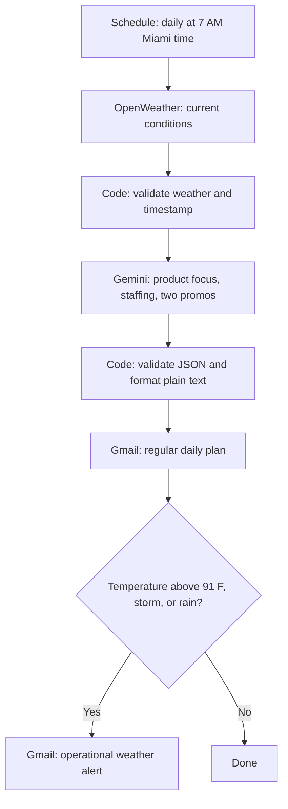

# Weather-Based Sales and Staffing Decisions

**Bayside Brews & Scoops, Miami, Florida**

Jason Teixeira · TripleTen AI Automation

Emily, the kiosk manager, needs a useful starting point before the day gets busy.
This project prepares a morning email with product priorities, a staffing suggestion,
and two short customer promos based on Miami weather. An optional second email flags
heat, rain, or storms under the assignment's alert rule.

**Status:** local build kit and automated validation tests are ready. The live Zap,
Postman request, Gemini generation, inbox delivery, scheduled run, and final slide
deck still need verification. The sample emails use synthetic weather and a
hand-authored plan. They are not live test evidence.

## Workflow



The required service sequence remains Schedule, OpenWeather, Gemini, Gmail.
Two Code by Zapier steps add checks before AI and email. They stop a run when the
weather mapping is invalid, an observation is over three hours old, or the AI
response lacks usable fields. The manager still controls stock and staffing.

## Run the local checks

Requires Node.js 22 or newer. No dependencies or API keys are needed for local tests.

```bash
cd projects/weather-based-sales-staffing
npm run build
npm run check
npm test
npm run test:coverage
npm run demo
```

`build` produces the exact scripts to paste into Code by Zapier. `demo` writes two
plain-text sample emails locally. Neither command contacts an API or sends email.

## Project files

| File | Purpose |
|---|---|
| [BUILD_KIT.md](BUILD_KIT.md) | Exact step setup and field mappings |
| [prompt.txt](prompt.txt) | Gemini prompt with a consistent JSON contract |
| [postman_collection.json](postman_collection.json) | Importable request with a private API-key variable |
| [zapier/workflow.json](zapier/workflow.json) | Setup manifest, not an importable Zap export |
| [zapier/](zapier/) | Generated Code by Zapier scripts |
| [src/planning.cjs](src/planning.cjs) | Validation, alert rule, and email formatting |
| [tests/](tests/) | Contract and generated-script integration tests |
| [templates/](templates/) | Clearly labeled simulated email examples |
| [PRESENTATION.md](PRESENTATION.md) | Copy aligned to the supplied Google Slides template |
| [evidence/README.md](evidence/README.md) | Live-proof checklist and test record |
| [SUBMISSION.md](SUBMISSION.md) | Submission links and remaining requirements |

## Decisions that matter

**Current weather versus forecast.** The assignment's `/weather` endpoint reports
current conditions. The prompt identifies that limitation and avoids invented
afternoon forecasts. A same-day forecast is a future enhancement. Current
`main.temp_max` is not today's predicted high.

**AI suggests, code checks.** Gemini chooses the recommendation. Code checks the
response format, fields, total word limit, and two promos of fewer than 120 Unicode
code points each. It computes alerts from the weather, independently of AI text.
These checks do not prove that every recommendation is accurate or sensible.

**Regular email first.** The alert filter follows the daily email so a clear day
still gets its summary. If Gemini or the regular email fails, downstream alerting
also stops. Independent alert delivery needs another route or Zap.

**The assignment's rain rule is broad.** Any description containing `rain` triggers
an operational alert, including light rain. This matches the rubric and does not
establish official severe-weather status. Drizzle alone does not match this rule.

**Delivery timing.** The schedule uses the Zapier account timezone, set to
America/New_York. Zapier may start within a few minutes of the chosen time.

## Safety and limits

- Configure the test recipient directly in Gmail. AI cannot choose recipients.
- Enter keys privately in Zapier/Postman. Do not commit them or screenshot them.
- Use plain-text email bodies so AI text cannot insert HTML.
- Stop and review failures instead of sending an empty or invented plan.
- Review Zap history before replaying a failed run to avoid duplicate emails.
- This project has no retry/deduplication service or independent safety monitoring.
- Measure time saved, sales, and waste before claiming business improvements.

## References

- [Supplied presentation template](https://docs.google.com/presentation/d/1oSvomOtgMT6Z-msUzkPApBAOdD0wG976CkDw2cGDn7U/edit)
- [OpenWeather current conditions](https://openweathermap.org/api/current)
- [OpenWeather forecast enhancement](https://openweathermap.org/api/forecast5)
- [Zapier scheduling and timezones](https://help.zapier.com/hc/en-us/articles/8496288648461-Schedule-Zaps-to-run-at-specific-intervals)
- [Gemini on Zapier](https://help.zapier.com/hc/en-us/articles/29858475126413-How-to-get-started-with-Google-AI-Studio-Gemini-on-Zapier)
- [Zapier plan requirements](https://help.zapier.com/hc/en-us/articles/8496181725453-Learn-key-concepts-in-Zap-workflows)
